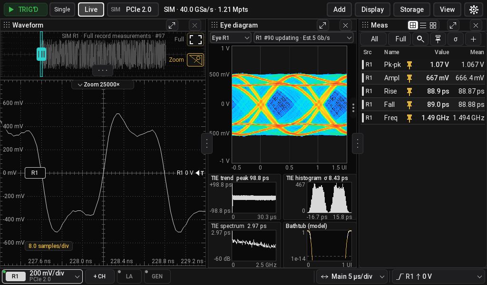
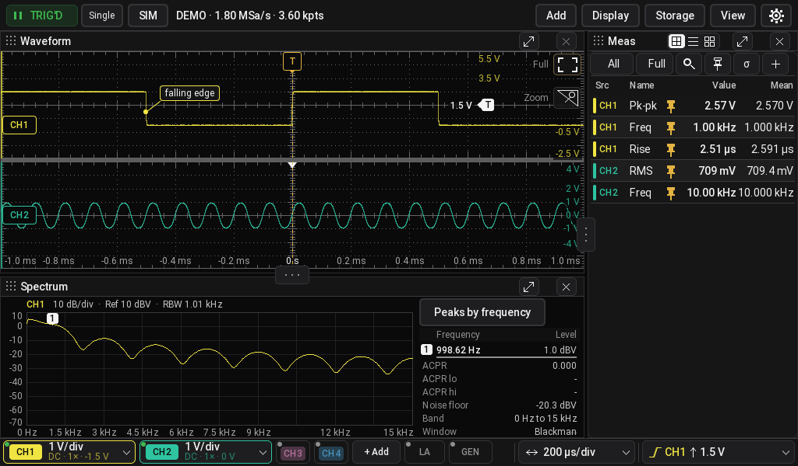
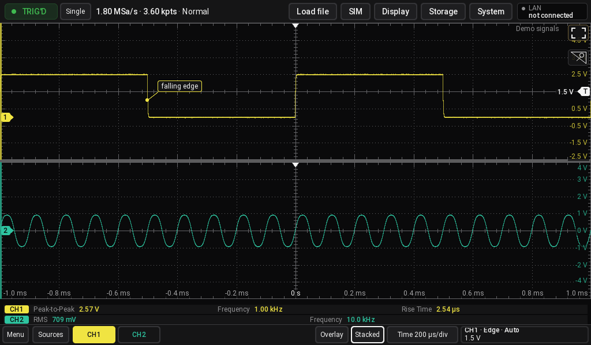
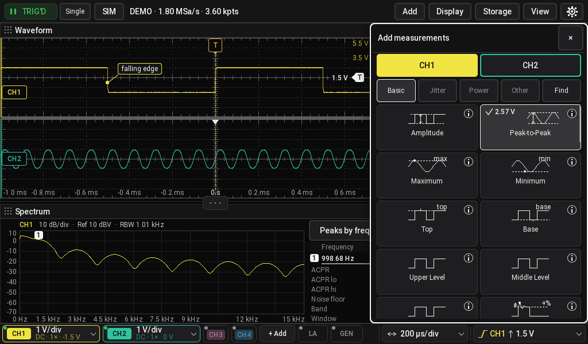
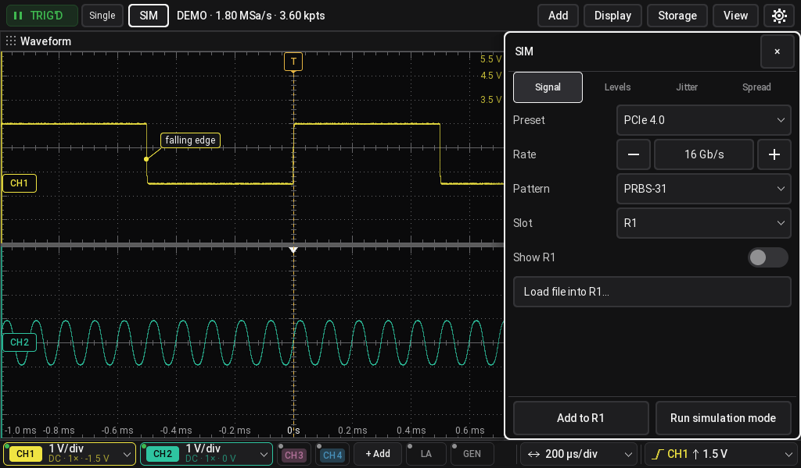

<h1 align="center">OOS Plus</h1>

<p align="center">
<b>OOS, plus a lab's worth of analysis, a Windows desktop app and full remote control,<br>
for the Rigol DHO800/DHO900 oscilloscopes.</b><br>
It runs on the scope from its SD card, and as a native Windows app with no scope at all.
</p>

<p align="center">
<b>202</b> commits of its own &nbsp;·&nbsp; <b>+45,800</b> lines of Rust &nbsp;·&nbsp;
<b>2,194</b> tests (OOS had 1,618) &nbsp;·&nbsp; <b>568</b> SCPI commands &nbsp;·&nbsp;
<b>21</b> fixes checked on a real DHO924S
</p>

<p align="center">
<a href="LICENSE"></a>
<a href="docs/models.md"></a>
<a href="#windows-desktop"></a>
<a href="docs/scpi.md"></a>
<a href="https://github.com/dekajoule/oos"></a>
</p>

<p align="center">

</p>

<p align="center"><sub>Studio layout: a simulated PCIe 2.0 lane with its eye, jitter charts and measurements.
Every picture on this page is the demo build, no scope attached.</sub></p>

> **Experimental software.** OOS Plus drives the hardware of the scope directly and is not a calibrated instrument.
> Much of what it adds is tested on a computer and not yet verified on hardware; [CHANGELOG.md](CHANGELOG.md) says
> which for every entry. Read the [disclaimer](docs/guide.md#disclaimer) before you install it. OOS Plus is not
> affiliated with RIGOL and contains no vendor code.

## Why OOS Plus

[OOS](https://github.com/dekajoule/oos) gives the DHO800/DHO900 a free, open operating system. OOS Plus builds on it
for people who use the scope as a lab instrument, not only as a screen:

- **Measure more, and trust it.** 60 standard, 20 two-source and more than 80 analysis measurements, each checked
  against a signal of known values. Eye and jitter, DDR timing, power, motor drives and magnetics are built in.
- **Work without the scope.** The same screen runs as a native Windows app, on demo signals, the simulator or your
  saved waveforms, including RIGOL `.bin` and `.pwwf` files.
- **Script everything.** 568 SCPI commands on one interpreter, over raw sockets, HiSLIP, VXI-11 and MCP for AI
  assistants, with a programming manual.
- **Arrange the screen for the job.** Default, Minimal and Studio layouts, with docked, tabbed and floating views.
- **Validated, not only written.** Since the version it shares with OOS, the tests went from 1,618 to 2,194. Each
  [CHANGELOG.md](CHANGELOG.md) entry says whether it ran on a real unit; 21 of them did, on a DHO924S. OOS Plus also
  takes OOS's fixes as they come.

## What it is

OOS Plus replaces the software of a DHO800/DHO900 with a Linux 6.12 kernel and a scope application written in Rust.
It starts from the scope's own SD card, next to the stock system, and you can switch back at any time.

It is built on [OOS](https://github.com/dekajoule/oos) by dekajoule, which did the hard part: the kernel, the cold
boot of the hardware, the acquisition and the scope itself. OOS Plus goes its own way from there, with its own
documentation, towards analysis, loaded waveforms, remote control and a desktop app. Single features may be offered
back to OOS as pull requests.

## Highlights

| | |
|---|---|
| **Measurements** | One page for all of them: 60 standard, 20 between two sources and more than 80 analysis measurements, on channels, math and references. Screen or full-record gate, statistics, and a tap on a badge draws what it measures on the trace. Many fixes, each checked against a signal of known values. |
| **Eye and jitter** | Auto Eye/Jitter recovers the clock and opens the eye with TIE trend, histogram, spectrum and bathtub. TJ, RJ and DJ, DCD, DDJ, PJ, spread-spectrum deviation and rate, phase noise. |
| **DDR DQ and DQS timing** | The eye folds on a strobe that runs in bursts, and Setup DDR, Hold DDR and their violation count take both clock edges. |
| **High-speed serial** | Lane presets from PCIe 1.0 to 5.0, USB 2.0 HS and 3.2, SATA and 10GBASE-KR, for simulated or loaded records: NRZ rate, de-emphasis, eye width at a BER. Not a compliance test. |
| **Power, motor, magnetics** | Power quality, harmonics, switching loss, ripple and rail sequencing; DQ0 transform, shaft speed and angle for motor drives; a magnetics page; a double-pulse page with switching times and diode recovery. |
| **Spectrum, Bode, more** | Spectrum with a peak list beside the waveform, Bode plot, bandwidth test, histogram, XY, mask and zone tests. |
| **Decoders** | 29 protocols, from UART, I2C, SPI and CAN to USB PD, FlexRay, MIL-STD-1553 and DCC. Each is a module of one file; a decoder reads the samples the acquisition kept, not the points of the screen. |
| **Three layouts** | **Default**, the screen of OOS. **Minimal**, a quiet screen with settings in sheets. **Studio**, views you dock, tab, float and resize: waveform lanes, measurements, eye, spectrum, tables, histogram. |
| **Skin** | Display > Skin gives the same screen another look: OOS or OOS Plus. |
| **References and sessions** | Ten reference slots (R1 to R10) that are measured, decoded, zoomed and triggered on like a channel. A session keeps the setup, the record and every reference in one `.oss` file. |
| **Waveform files** | Open CSV, OOS BIN, WFM, waveform records (`.pwwf`) and RIGOL or Keysight `.bin` files, beside the live channels or offline with no acquisition. |
| **Callouts** | Hold on a trace and pin a note to that time on that signal. It moves with the signal and is kept in the setup and the session. |
| **SIM** | A signal simulator with tabs for Signal, Levels, Jitter and Spread: PRBS patterns, rise time, bandwidth, de-emphasis, noise, random and periodic jitter, SSC. Play it as the acquisition or add it to a reference. |
| **Remote control** | 568 SCPI headers on one interpreter: the DHO800/DHO900 subset scripts use, plus commands for every analyser, the Studio dock (`:DOCK`), the controls on the screen (`:UI`), callouts and sessions. |

<table>
<tr>
<td></td>
<td></td>
</tr>
<tr>
<td align="center"><sub>Studio: lanes, a callout, the spectrum and the measurement table</sub></td>
<td align="center"><sub>Minimal: the plot first, measurements in a strip</sub></td>
</tr>
<tr>
<td></td>
<td></td>
</tr>
<tr>
<td align="center"><sub>Add measurements: each tile shows what it measures</sub></td>
<td align="center"><sub>The SIM sheet</sub></td>
</tr>
</table>

The full list, version by version, is in [CHANGELOG.md](CHANGELOG.md). How the measurement page, loaded waveforms and
the automatic eye work is in [docs/reference-analysis.md](docs/reference-analysis.md).

## Windows desktop

The same screen runs as a native Windows app: demo signals, the simulator and your waveform files, with every
measurement, decoder and analyser, and the same remote interfaces. No scope is needed.

You need a Windows [Rust](https://rustup.rs) toolchain. From PowerShell, in the checkout:

```powershell
.\build-windows.ps1 -Run        # release build, then open the window
.\run-windows.ps1 -Watch        # development: rebuild and restart when a source file is saved
```

The app is `ui\target\release\oos-ui.exe`. The mouse is the finger, the wheel pans, Ctrl+wheel zooms the time base,
Space is Run/Stop and F12 saves a screenshot; all keys are listed at the top of
[ui/src/desktop.rs](ui/src/desktop.rs). Ctrl+O opens a waveform file, and so does dropping one on the program or
`--open FILE`. `--offline` starts with the analog channels off, for work on stored waveforms.

**The network services stay on your PC.** The web remote (8080), SCPI (5555) and HiSLIP (4880) listen on
`127.0.0.1` only, so Windows asks no firewall question and nobody else on the network can reach them. Start the app
with `--lan` to open them to the network; they have no authentication, so do that on a trusted bench network only.

```powershell
ui\target\release\oos-ui.exe --lan
.\run-windows.ps1 -WebPort 18080 -ScpiPort 15555 -HislipPort 14880    # other ports
```

On macOS and Linux the screen runs without a window, behind the same services:
`(cd ui && cargo run -- --serve)`, then open `http://localhost:8080`.

## SCPI and remote control

Every transport feeds the same interpreter, on the scope and in the desktop app.

| Interface | Port | Notes |
|---|---|---|
| Raw socket SCPI | TCP 5555 | recommended for scripts: `TCPIP0::<address>::5555::SOCKET` |
| HiSLIP | TCP 4880 | the desktop app and `--serve`: `TCPIP0::<address>::hislip0::INSTR` |
| VXI-11 | 111, 9009 | on the scope: `TCPIP0::<address>::INSTR` |
| HTTP | 8080 | web remote with the live screen; `POST /mcp` gives AI assistants the tools `scpi` and `screenshot` |

A measurement in Python, with nothing but the standard library:

```python
import socket

scope = socket.create_connection(("127.0.0.1", 5555), timeout=5)   # the desktop app, or the scope's address
io = scope.makefile("rw", newline="\n")


def ask(command):
    io.write(command + "\n")
    io.flush()
    return io.readline().strip()


print(ask("*IDN?"))                                   # OOS,DHO924S,0,oos-ui 0.1.13
io.write(":CHANnel1:SCALe 0.5\n:MEASure:ITEM VPP,CHAN1\n")
print("Vpp:", float(ask(":MEASure:ITEM? VPP,CHAN1")), "V")
print(ask(":SYSTem:ERRor?"))                          # 0,"No error"
```

- [docs/scpi.md](docs/scpi.md): the reference, one page per command group, with connection, syntax and error codes.
- [SCPI Programming Manual](docs/OOS-Plus-SCPI-Programming-Manual.pdf) (PDF): every command with its syntax,
  parameters, reply format and an example.
- [docs/network.md](docs/network.md): the services on the scope, their switches, the firewall and `net.allow`.

OOS Plus implements a subset of the DHO800/DHO900 command set and its own extensions. It does not impersonate the
stock firmware: `*IDN?` answers OOS.

## Install on the scope

OOS Plus goes on the SD card of the scope and starts beside the stock system. There are three ways, and each has its
page:

| Way | Opens the scope | Guide |
|---|---|---|
| A second SD card, the original stays in a drawer | yes | [docs/guide.md](docs/guide.md#installation) |
| USB stick, through the stock system | no | [docs/install-usb.md](docs/install-usb.md) |
| ADB over the network | no | [docs/guide.md](docs/guide.md#over-adb) |

Before anything else, **back up the whole original card**: [docs/sdcard-backup.md](docs/sdcard-backup.md). It holds
the factory calibration, which cannot be replaced. Updates of a running system are signed packages with a trial
start and a rollback: [docs/update.md](docs/update.md). Supported models and their limits:
[docs/models.md](docs/models.md). Test images are on the
[releases page](https://github.com/wasimlhr/oos-plus/releases).

What is never written, by the installer or by the running system:

- the FPGA flash;
- `/rigol/data`, the calibration and identity of the stock system;
- the `uboot`, `trust` and `parameter` partitions.

If something goes wrong, or to go back to stock: [docs/guide.md](docs/guide.md#if-something-goes-wrong).

## Building from source

```sh
tools/check.sh                       # every enforced host check, as CI runs them
(cd ui && cargo test)                # one crate
(cd ui && cargo run -- --serve)      # no display, no hardware: demo signals behind SCPI :5555 and the web page :8080
```

Each crate builds on its own. What runs on the scope depends on `libc` only; the Windows window
adds `minifb` and `windows-sys`. The image for the scope (kernel, initramfs and the Rust programs for
`aarch64-unknown-linux-musl`) is built with Docker on macOS or Linux:
[docs/guide.md](docs/guide.md#3-build-the-kernel), steps 3 to 5. How the pieces fit:
[docs/architecture.md](docs/architecture.md).

## Project layout

| Path | What |
|---|---|
| `hal/` | `oos-hal`: register sequences, front ends, ADC, PLL, cold boot, models (pure, behind a `Bus` trait) |
| `dsp/` | `oos-dsp`: signal processing, measurements, decoders, eye and jitter, free of hardware |
| `ui/` | `oos-ui`: the screen, the layouts, SCPI, VXI-11, HiSLIP, the web remote, the Windows window |
| `fpgad/` | `oos-fpgad`, the bring-up command line, and `oos-update` |
| `gpu/` | GPU helper process (C, Mesa) |
| `boot/`, `kernel/`, `rootfs/` | image packer and installers, kernel 6.12, initramfs scripts |
| `keys/` | public keys trusted for updates |
| `tools/` | host tools and checks; [tools/README.md](tools/README.md) says which ones touch a scope |
| `docs/` | documentation ([index](docs/README.md)); `docs/adr/` the decisions, `docs/scpi/` the command reference |
| `build-windows.ps1`, `run-windows.ps1` | build and run the Windows app |

## Contributing

Reports from hardware, measurements and code are welcome. [CONTRIBUTING.md](CONTRIBUTING.md) has the ground rules
and how to add a decoder, a measurement or an analyser page; [AGENTS.md](AGENTS.md) is the short form, for people
and coding agents alike. The main ones:

- no vendor code, data or material, in the tree or in the texts around it;
- no personal data: no serial numbers, MAC addresses, licence keys or a scope's address;
- commits are signed off (`git commit -s`);
- say how a hardware fact is known: verified on the unit, assumed, or not yet verified on hardware;
- run `tools/check.sh` before you say a change is done.

Security reports: [SECURITY.md](SECURITY.md).

## Licence

OOS Plus is free software under the GNU General Public License, version 2 or (at your option) any later version:
[LICENSE](LICENSE). Third-party parts keep their own licences, listed in
[THIRD-PARTY-LICENSES.md](THIRD-PARTY-LICENSES.md). If you pass on an image, the GPL requires you to provide the
corresponding source as well.

## Credits

- **[OOS](https://github.com/dekajoule/oos)** by dekajoule is the base of this project, under GPL-2.0-or-later: the
  kernel work, the cold boot, the acquisition, the scope application and the documentation of the hardware. OOS Plus
  would not exist without it. Thank you.
- The contributors to OOS whose work is in this tree, among them ichnograph (hardware functions, SSH, the firewall)
  and Arjen Halma (the DCC decoder).
- The projects OOS itself builds on, from NovaOS and the Linux kernel to BusyBox, Rust and the Roboto typeface, are
  thanked one by one in [docs/guide.md](docs/guide.md#thanks).

OOS Plus is an independent project. It is not affiliated with, endorsed by or supported by RIGOL TECHNOLOGIES CO.,
LTD. or by the OOS project. Rigol and all other names are trademarks of their owners and are used only to identify
the hardware.
